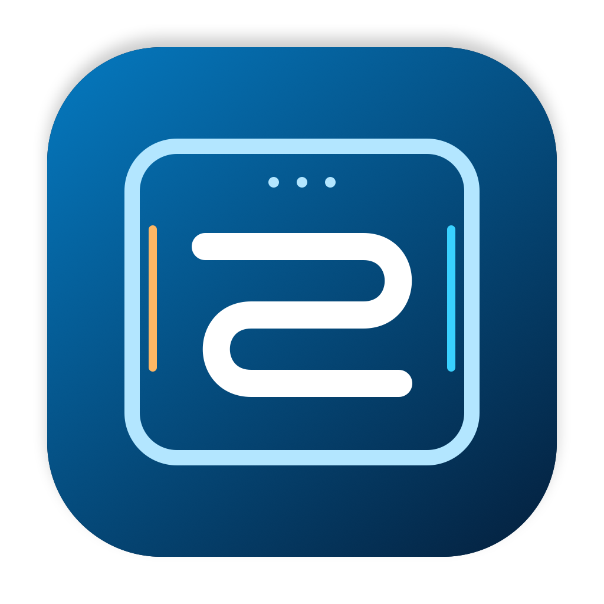
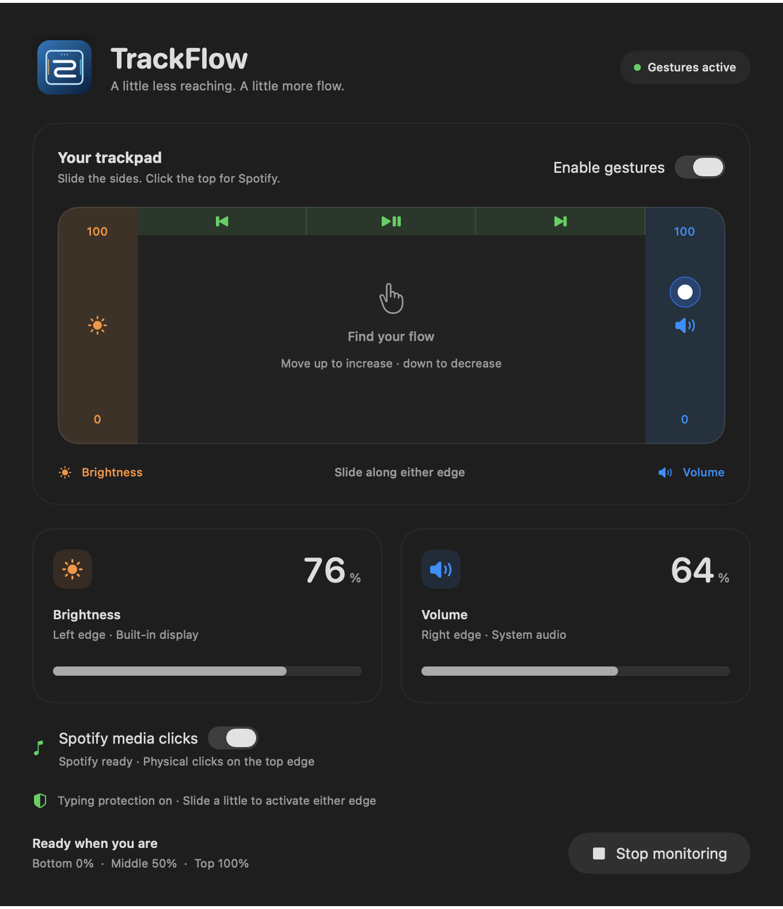
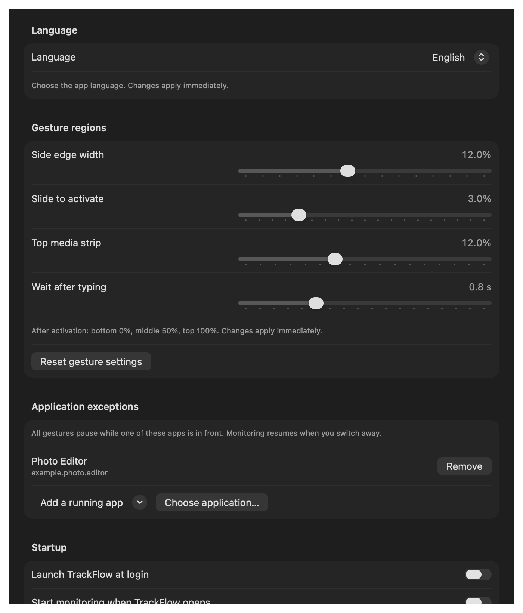

<h1 align="center">TrackFlow</h1>

Your trackpad. In flow.

SwiftUI · macOS · MIT · English / Türkçe

[English](README.md) · [Türkçe](README.tr.md)

Turn the edges of your Mac trackpad into deliberate volume, brightness and
Spotify shortcuts. TrackFlow stays in the menu bar and gives you a small,
nonactivating feedback panel without interrupting your work.

> **0.1.0 alpha:** source is publicly available. No official notarized binary
> has been published. Build from source until a verified release is available.

## What it does

| Region | Action |
| --- | --- |
| Left edge | Built-in display brightness |
| Right edge | System volume |
| Top left / center / right, excluding corners | Spotify previous / play-pause / next via physical click |

A short vertical slide activates each side. After activation, bottom is 0%,
middle 50% and top 100%. Typing disarms the sides and delays reactivation for
800 ms by default. Ordinary contact and small jitter do not immediately
change levels.

- Persistent menu bar: pause, resume, reopen the window or quit.
- Adjustable edge widths, activation distance, top strip and typing delay.
- Per-application exclusions that automatically pause all gestures.
- Opt-in launch at login and automatic monitoring.
- Spotify title, artist and album artwork when available.
- Immediate English/Turkish language switching and a replayable setup guide.
- Contact drawing isolated from the main UI, capped at 30 Hz only while visible.

## Requirements

- macOS 15.0 or newer; this is the compiled deployment target.
- Xcode 27 or newer to open the current project format.
- A compatible Multi-Touch trackpad.
- Spotify desktop app, running, for media controls.

Development and physical behavior have been checked on Apple Silicon with
macOS 27/Xcode 27.2. Universal arm64/x86_64 compilation is checked locally;
Intel hardware and older macOS runtime behavior still need community testing.

## Build from source

1. Clone or download [bugrayumru2/TrackFlow](https://github.com/bugrayumru2/TrackFlow).
2. Open **TrackFlow.xcodeproj** in Xcode.
3. Select **TrackFlow → My Mac**.
4. Build and run. If distributing a build, use your own signing identity.
5. Follow the guide, then select **Start monitoring**.

Command-line developer builds:

~~~sh
./scripts/build.sh Debug
./scripts/build.sh Release
~~~

These scripts deliberately disable signing. Products are written to
.build/DerivedData/Build/Products. The committed Package.resolved is enforced.
Release uses optimization; Debug is intended for development.

## Permissions

In **System Settings → Privacy & Security → Accessibility**, allow the
actual running TrackFlow app. This enables typing observation in other apps
and consumed physical media clicks. Allow **Automation → Spotify** when asked.

Ad-hoc development rebuilds can change the code signature. If settings show
an old allowed copy but TrackFlow still reports missing access, remove the
stale entry and add the exact current app, then restart it.

The stable application identifier is **dev.trackflow.TrackFlow**. Earlier
development prototypes used a different identifier; that permission record
does not grant access to this build.

## Settings and daily use

Settings contains Language, Gesture regions, Application exceptions, Startup
and Help. Changes persist and apply immediately. Language switching does not
restart monitoring.

Closing the main window keeps controls active. Use the menu bar to pause or
quit. Launch at login and monitoring on launch are separate opt-ins; install
the built app at a stable location before registering a login item.

## Privacy and limitations

- No analytics or account. No typed text or key codes are stored; keyboard
  observation retains only the time of a key-down event.
- Gesture settings and exclusions are stored locally in UserDefaults.
- Spotify automation stays local. Album art is fetched over HTTPS from
  Spotify CDN domains; those servers receive normal image requests.
- If global typing observation is unavailable, short-slide activation and
  local typing protection remain. Secure input can hide keyboard events;
  it must never permanently disable side controls.
- Brightness uses an optionally loaded private DisplayServices API and
  supports the built-in display only. It may require changes on future macOS.
- OpenMultitouchSupport also relies on private multitouch APIs; App Sandbox
  is disabled. This project does not claim Mac App Store eligibility.
- Some output devices do not support system software volume.
- Media clicks correlate positive mouse-button pressure with a fresh single
  trackpad contact. A separate mouse click while resting a finger on the
  top region can also match. Test physical behavior on your hardware.

## Verification

~~~sh
./scripts/check.sh
./scripts/build.sh Debug
./scripts/check-localization.sh "$PWD/.build/DerivedData/Build/Products/Debug/TrackFlow.app"
python3 scripts/check-workspace.py
~~~

Logic checks exercise activation, jitter, typing delay, default/custom media
mapping, settings persistence and validation, exclusions, keyboard availability
and UI update isolation. Workspace checks use local test preferences and do
not start hardware monitoring or register a login item.

GitHub Actions uses the official [xcode-27 runner image](https://github.blog/changelog/2026-10-15-xcode-27-runner-image-generally-available/), checks Debug and
Release, and retains an explicitly unsigned developer artifact. Live results are available from the build badge above. Spotify dictionary
compilation is optional when Spotify is not installed; core logic checks
always run. Locally, TRACKFLOW_TEST_WITHOUT_SPOTIFY=1 exercises that CI path.

## Releases, contributions and license

- [Release checklist and signing](docs/RELEASING.md)
- [Architecture and developer notes](docs/ARCHITECTURE.md)
- [Contributing](CONTRIBUTING.md) · [Security](SECURITY.md) · [Changelog](CHANGELOG.md)
- [MIT license](LICENSE) · [Third-party notices](THIRD_PARTY_NOTICES.md)
- [Original logo sources](branding)

TrackFlow is independent and is not affiliated with or endorsed by Spotify or Apple.
