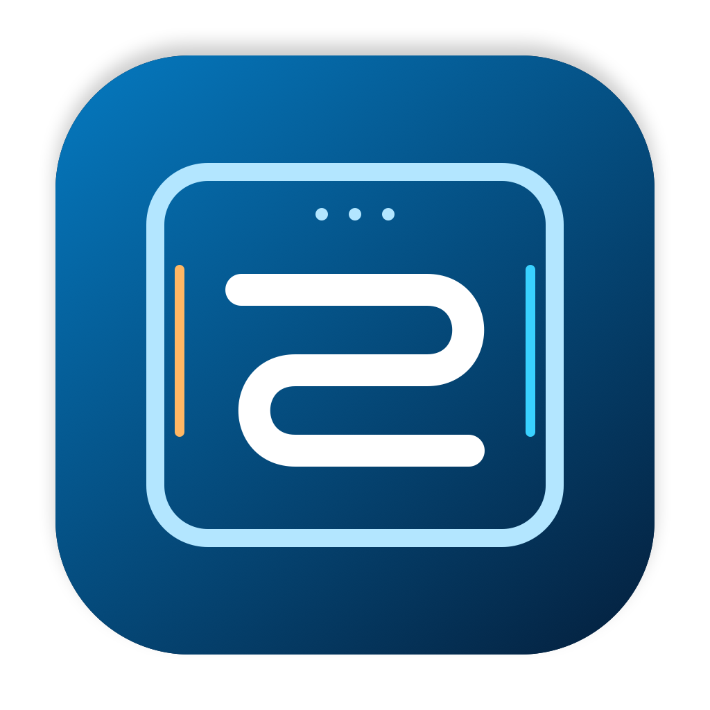
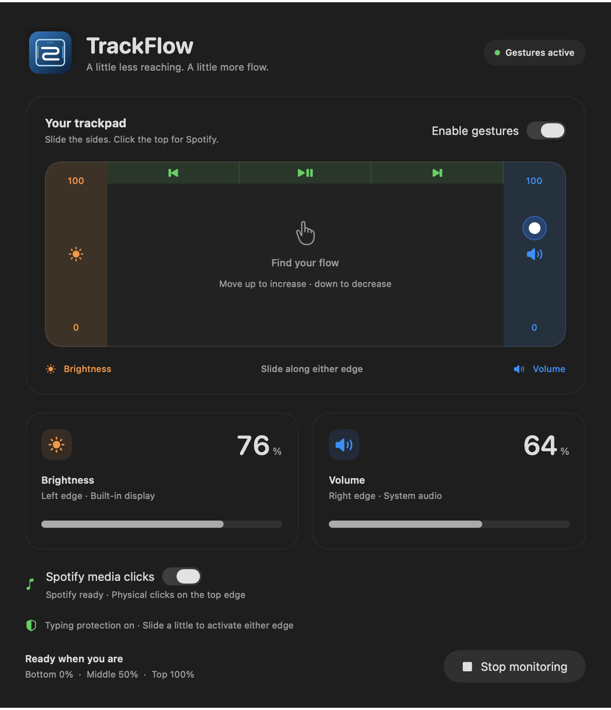

<h1 align="center">TrackFlow</h1>

Trackpad’inle akışını yakala.

[English](README.md) · [Türkçe](README.tr.md)

Trackpad’in kenarlarından ses, dahili ekran parlaklığı ve Spotify’ı kontrol eden,
menü çubuğunda çalışan açık kaynak macOS uygulaması.

> **0.1.0 alfa:** Kaynak kod herkese açık olarak yayınlandı. Henüz resmî, noter onaylı
> bir uygulama paketi yayınlanmadı. Şimdilik kaynak koddan derleyin.

## Kontroller

- Sol kenar: dahili ekran parlaklığı.
- Sağ kenar: sistem sesi.
- Üst bölüm: fiziksel tıklamayla önceki şarkı, durdur/başlat, sonraki şarkı.
- Yan kontroller kısa bir dikey kaydırmayla etkinleşir: alt %0, orta %50, üst %100.
- Yazarken yan kontroller sıfırlanır; varsayılan bekleme son tuştan sonra 800 ms’dir.
- Menüden duraklatın, sürdürün, pencereyi açın veya tamamen çıkın.

Ayarlar’dan dil, kenar genişlikleri, kaydırma eşiği, yazma beklemesi, uygulama
istisnaları ve isteğe bağlı otomatik başlatma ayarlanabilir. Dil değişimi
yeniden başlatma gerektirmez. Pencereyi kapatmak kontrolleri durdurmaz.

## Kurulum ve izinler

Derleme hedefi macOS 15.0+, proje biçimi Xcode 27+ gerektirir. Fiziksel kullanım
Apple Silicon/macOS 27 üzerinde denenmiştir; eski macOS ve Intel donanımında
ek doğrulama gerekir.

1. Projeyi indirip **TrackFlow.xcodeproj** dosyasını Xcode’da açın.
2. **TrackFlow → My Mac** seçip çalıştırın.
3. **Sistem Ayarları → Gizlilik ve Güvenlik → Erişilebilirlik** bölümünde
   çalışan TrackFlow sürümüne izin verin.
4. Spotify için istenen **Otomasyon** iznini verin. Spotify açık olmalıdır.
5. Başlangıç rehberini tamamlayıp izlemeyi başlatın.

Geliştirme sürümünün imzası değişirse eski Erişilebilirlik kaydını kaldırıp
güncel uygulamayı yeniden eklemek gerekebilir. Kalıcı kimlik
**dev.trackflow.TrackFlow**’dur.

## Gizlilik ve sınırlar

Yazılan metin veya tuş kodları kaydedilmez; yalnızca basış zamanı tutulur.
Ayarlar bilgisayarda saklanır. Analitik ve hesap sistemi yoktur.
Spotify kapakları HTTPS ile Spotify sunucularından alınır.

Parlaklık ve multitouch erişimi özel macOS API’leri kullanır. App Sandbox
kapalıdır; Mac App Store uyumluluğu iddia edilmez. Yalnızca dahili ekran
parlaklığı desteklenir. Bazı ses aygıtları yazılımsal ses kontrolü sağlamaz.

## Geliştirme

~~~sh
./scripts/check.sh
./scripts/build.sh Debug
./scripts/check-localization.sh "$PWD/.build/DerivedData/Build/Products/Debug/TrackFlow.app"
python3 scripts/check-workspace.py
~~~

[İngilizce ayrıntılı belge](README.md), [sürüm hazırlama](docs/RELEASING.md),
[katkı rehberi](CONTRIBUTING.md) ve [bağımlılık lisansları](THIRD_PARTY_NOTICES.md).

Kaynak kod ve özgün logo **MIT lisanslıdır**. TrackFlow, Spotify veya Apple
ile bağlantılı değildir ve bu şirketlerce desteklenmemektedir.
